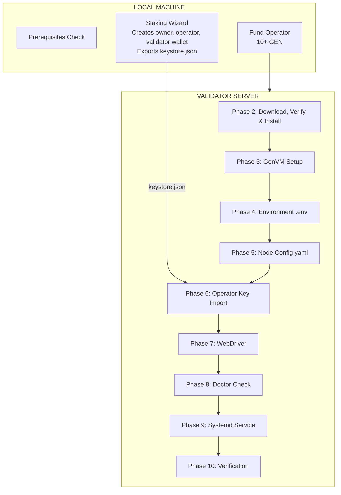

# GenLayer Validator Node Installation Procedure

## Goal
Install a GenLayer validator node (or a full node) from scratch on a Linux server, ready to sync and validate.

## Process Overview



## Prerequisites

Before starting, ensure:
- **Architecture**: AMD64 (x86_64) - check with `uname -m`
- **RAM**: 16GB+ (32GB recommended)
- **CPU**: 8+ cores (16+ recommended)
- **Disk**: 128GB+ SSD (256GB+ recommended)
- **OS**: Ubuntu 22.04+, Debian 12+, or compatible (Python 3.10+)

### Required Software

```bash
# Check all prerequisites (on the server)
docker --version        # v20.10+ required
docker compose version  # Compose plugin required
python3 --version       # Python 3.10+ required
pip3 --version          # pip3 required
python3 -c 'import venv, ensurepip'  # venv module required ('python3 -m venv --help' passes without python3-venv)
cosign version          # verifies the release signature
```

Node.js v20+ is needed only where the GenLayer CLI runs (the staking wizard, LOCAL machine),
not on the server.

Install missing dependencies (show the list and ask the user to confirm first):
```bash
# Docker ('env -u VERSION': the get.docker.com script reads $VERSION as the Docker version to install)
curl -fsSL https://get.docker.com | env -u VERSION sh
sudo usermod -aG docker $USER

# Python dependencies
sudo apt install -y python3 python3-pip python3-venv

# cosign (pinned release)
curl -fsSLo /tmp/cosign.deb https://github.com/sigstore/cosign/releases/download/v2.4.1/cosign_2.4.1_amd64.deb
sudo dpkg -i /tmp/cosign.deb && rm /tmp/cosign.deb

# Service user for the node — NOT in the docker group (docker-group membership is root-equivalent)
sudo useradd --system --create-home --home-dir /var/lib/genlayer --shell /usr/sbin/nologin genlayer
```

## Installation Phases

### Phase 1: Staking Wizard (Local Machine)

**Skip if you already have a validator wallet address and operator keystore, or for a full node
(`node.mode: "full"`: no staking, no operator key).**

The staking wizard runs on your **local machine** (not the server) to create wallet keys securely.

```bash
# Install GenLayer CLI — the exact version named in the release announcement for your network
npm install -g "genlayer@${CLI_VERSION}"

# Create and unlock owner account
genlayer account create --name "My Validator Owner"
genlayer account unlock --account "My Validator Owner"

# Fund the owner account with the deployed self-stake minimum + gas, then run wizard
genlayer staking epoch-info --network testnet-bradbury   # deployed minimum (42,000 GEN is the protocol default)
genlayer staking wizard --account "My Validator Owner" --network testnet-bradbury
# (--network: your network's CLI alias; testnet-bradbury is the testnet documented today)
```

Phase 2 registration signs a proof of possession with the operator key: the operator must be an
account the CLI holds (create it in the wizard). An operator address alone fails.

**Save these outputs from the wizard:**
| Item | Example | Used For |
|------|---------|----------|
| Validator Wallet | `0x1451c990...` | config.yaml |
| Operator Address | `0x992fff41...` | config.yaml |
| Keystore File | `Operator-keystore.json` | Upload to server |
| Export Passphrase | (you set it) | `.env` on the server (`GENLAYERNODE_PASSWORD`) |

**Fund the operator after wizard:**
```bash
# Check balances
genlayer account show --account "My Validator Owner"
genlayer account show --account "My Validator Operator"

# Send GEN from owner to operator (10 GEN minimum recommended)
genlayer account send 0xOPERATOR_ADDRESS 10gen \
  --account "My Validator Owner" \
  --network testnet-bradbury
```

**See `staking-wizard-procedure.md` for detailed wizard walkthrough.**

---

### Phase 2: Download, Verify & Install (Server)

All remaining steps run on the **validator server**.

> **See `common-procedures.md`** for detailed commands.

```bash
VERSION=v0.6.0   # the exact version approved for your network (release announcement)

# Download, verify (cosign + SHA256), install with the release install.sh
# See: common-procedures.md -> "Download & Extract Node Software"

# Shared data directory (all v0.6.x) and the version's data/ link
# See: common-procedures.md -> "Create Directory Structure"

# Setup symlinks
# See: common-procedures.md -> "Setup Symlinks"
```

Check first that the tarball, `genlayer-node_${VERSION}_SHA256SUMS`, its `.sigstore.json` and
`install.sh` all exist (`curl -fI`): on any 404, stop — never fall back to an older version.
Release files supplied by the user (a pre-release build) have no `.sigstore.json`: run only the
`sha256sum -c` check and tell the user the provenance was not verified.

### Phase 3: GenVM Setup (Server)

> **See `common-procedures.md` -> "GenVM Setup"**

`install.sh` (Phase 2) runs it in the final directory. Re-run it only after a failure:

```bash
cd /opt/genlayer-node/${VERSION}
sudo -u genlayer python3 "$(sed -n 's/^ *root_dir: *//p' configs/node/config.yaml)/bin/setup.py"
```

This verifies the runners and precompiles them (~2 minutes). Wait for completion. It writes the
directory's absolute path into the GenVM binaries: never move the directory afterwards.

### Phase 4: Environment Configuration (Server)

```bash
# Create .env from example (mode 600: it holds secrets)
sudo -u genlayer cp /opt/genlayer-node/${VERSION}/.env.example /opt/genlayer-node/${VERSION}/.env
sudo chmod 600 /opt/genlayer-node/${VERSION}/.env
```

**The user edits .env to add these values** (`sudo nano /opt/genlayer-node/${VERSION}/.env`):
```bash
# API key of your network's RPC provider, if it needs one (Testnet Bradbury: Conduit,
# https://app.conduit.xyz/rpc-keys — its WebSocket refuses connections without it).
# The RPC URLs are in config.yaml (Phase 5).
GENLAYERNODE_ROLLUP_GENLAYERCHAINRPCKEY=your-rpc-provider-key

# Required: LLM API key (set ONE based on your provider)
# HEURISTKEY=your-api-key-here
# COMPUT3KEY=your-api-key-here
# IOINTELLIGENCEKEY=your-api-key-here
# OPENROUTERKEY=your-api-key-here
# (see common-procedures.md for full provider list)

# Validator only: the operator keystore's export passphrase.
# Binary (systemd) reads GENLAYERNODE_PASSWORD (add the line); Docker reads NODE_PASSWORD.
GENLAYERNODE_PASSWORD=your-export-passphrase

# Docker only: the exact version, never latest
NODE_VERSION=v0.6.0
```


**Select LLM strategy and enable provider:**

> **See `common-procedures.md` -> "LLM Strategy Selection"** for strategy details.

```bash
# GenVM config dir = <genvm.root_dir in config.yaml>/config
GENVM_CFG=$(cd /opt/genlayer-node/${VERSION} && readlink -f "$(sed -n 's/^ *root_dir: *//p' configs/node/config.yaml)")/config

# Apply release LLM config (includes all backends)
sudo -u genlayer cp ${GENVM_CFG}/genvm-modules-llm-release.yaml \
   ${GENVM_CFG}/genvm-module-llm.yaml

# If using greybox strategy (deterministic via OpenRouter), switch lua script:
sudo -u genlayer sed -i 's/genvm-llm-default\.lua/genvm-llm-greybox.lua/' \
  ${GENVM_CFG}/genvm-module-llm.yaml
```

> **See `common-procedures.md` -> "Enable LLM Provider"** for provider mapping table.

```bash
# Enable your provider (replace <provider> with provider name)
sudo -u genlayer sed -i '/^  <provider>:/,/^  [a-z]/ s/enabled: false/enabled: true/' \
  ${GENVM_CFG}/genvm-module-llm.yaml
```

### Phase 5: Node Configuration (Server)

The tarball ships `configs/node/config.yaml` (install.sh already set its `genvm.root_dir`);
edit it in place. The network values are per-deployment: take them from
your network's section in the docs ("Network-Specific Consensus Configuration"); for your own network, from its operator.
Since v0.6 the node also needs the network's **protocol manifest**. Example — Testnet Bradbury:

```bash
sudo -u genlayer curl -fsSL https://docs.genlayer.com/validators/bradbury.protocol-manifest.json \
  -o /opt/genlayer-node/${VERSION}/configs/node/protocol-manifest.json
python3 -c "import json; m=json.load(open('/opt/genlayer-node/${VERSION}/configs/node/protocol-manifest.json')); print(m['chainId'], m['registry'])"
# Must match consensus.chainid and consensus.consensusaddress (Testnet Bradbury: 4221 0x3F71AE080BD6270A91dBcc7960d88797828538E0)
```

**Edit config.yaml to set the network values, the mode and validator addresses**
(replace each key in its section; never add a second `rollup:` or `consensus:`). Example — Testnet Bradbury:
```yaml
rollup:
  genlayerchainrpcurl: "https://rpc.testnet-chain.genlayer.com/"
  genlayerchainwebsocketurl: "wss://rpc.testnet-chain.genlayer.com/"
  provider: "conduit"

consensus:
  consensusaddress: "0x3F71AE080BD6270A91dBcc7960d88797828538E0"
  chainid: "4221"
  manifestpath: "configs/node/protocol-manifest.json"
  genesis: 47930

node:
  mode: "validator"                     # or "full" (no addresses needed)
  validatorWalletAddress: "0xYOUR_VALIDATOR_WALLET_ADDRESS"
  operatorAddress: "0xYOUR_OPERATOR_ADDRESS"
```


### Phase 6: Operator Key Import (Server, validator only)

**Option A: Upload keystore.json from wizard**

1. Create keystore directory:
   ```bash
   sudo install -d -m 700 -o genlayer -g genlayer /opt/genlayer-node/${VERSION}/data/node/keystore
   ```

2. Upload the keystore file (from local machine):
   ```bash
   # For GCP:
   gcloud compute scp ./Operator-keystore.json INSTANCE:/tmp/ \
     --project=PROJECT --zone=ZONE

   # For SSH:
   scp ./Operator-keystore.json user@host:/tmp/

   # For AWS with SSM only: upload to an S3 bucket the instance role can read, then on the server
   # aws s3 cp s3://BUCKET/Operator-keystore.json /tmp/  (delete the S3 object after)
   ```

3. Install the keystore as-is (on server). It stays encrypted; no password on any command line —
   the user sets `GENLAYERNODE_PASSWORD` in .env to its export passphrase:
   ```bash
   cd /opt/genlayer-node/${VERSION}
   # Stop if operator.json exists: the keystore is shared by all v0.6.x versions (never overwrite it)
   sudo test ! -e ./data/node/keystore/operator.json && \
   sudo install -m 600 -o genlayer -g genlayer /tmp/Operator-keystore.json ./data/node/keystore/operator.json && \
   sudo shred -u /tmp/Operator-keystore.json
   ```

4. Verify import:
   ```bash
   sudo ls -la /opt/genlayer-node/${VERSION}/data/node/keystore/
   # Should show the keystore file (doctor does not unlock it; the node does at start)
   ```

**Option B: Copy from previous installation** (not needed between v0.6.x versions: the data
directory, keystore included, is shared)
```bash
sudo -u genlayer cp -a /opt/genlayer-node/OLD_VERSION/data/node/keystore/. \
      /opt/genlayer-node/${VERSION}/data/node/keystore/
```

### Phase 7: Start WebDriver (Server)

> **See `common-procedures.md` -> "Start WebDriver"**

```bash
cd /opt/genlayer-node
sudo docker compose up -d   # sudo: .env is mode 600 (secrets)
sudo docker compose up -d docker-socket-proxy   # optional: WebDriver metrics for a binary node

# Wait for healthy status (at most 3 minutes)
for i in $(seq 1 36); do
  sudo docker inspect --format='{{.State.Health.Status}}' genlayer-node-webdriver 2>/dev/null | grep -q '^healthy$' && break
  echo "Waiting for WebDriver..."
  sleep 5
done
```

### Phase 8: Doctor Check (Server)

> **See `common-procedures.md` -> "Doctor Check"**

```bash
cd /opt/genlayer-node/${VERSION}
sudo -u genlayer bash -c 'set -a && . ./.env && set +a && ./bin/genlayernode doctor'
```

All checks should pass before proceeding: GenLayer Chain RPC + WebSocket, the consensus
deployment against the manifest (registry sealed, chain id matches), GenVM, at least one LLM provider,
WebDriver. A full node without an LLM key fails only the LLM check (it still syncs).

### Phase 9: Start Node Service (Server)

> **See `common-procedures.md` -> "Systemd Service"** for full service file.

**Create systemd service:**
```bash
sudo tee /etc/systemd/system/genlayer-node.service << 'EOF'
[Unit]
Description=GenLayer Node
After=network.target docker.service
Requires=docker.service

[Service]
Type=simple
User=genlayer
Group=genlayer
WorkingDirectory=/opt/genlayer-node
EnvironmentFile=/opt/genlayer-node/.env
Environment=DOCKER_HOST=tcp://127.0.0.1:2375
ExecStart=/opt/genlayer-node/bin/genlayernode run -c /opt/genlayer-node/configs/node/config.yaml
ExecStartPost=-+/bin/sh -c 'sleep 5 && /usr/bin/docker restart genlayer-node-alloy >/dev/null 2>&1 || true'
Restart=always
RestartSec=10

[Install]
WantedBy=multi-user.target
EOF
```

> **Note:** The `ExecStartPost` automatically restarts the Alloy telemetry container when the
> node starts. This prevents stale bind mount issues where Alloy stops sending logs after
> upgrades. The `-` prefix means failures are ignored (e.g., if monitoring isn't enabled); the `+`
> runs it as root, because the `genlayer` service user is not in the docker group.
>
> No password is on the command line: the node reads `GENLAYERNODE_PASSWORD` from the
> `EnvironmentFile`. `DOCKER_HOST` points at the read-only docker-socket-proxy (Phase 7).
>
> **Docker Compose instead of systemd:** see SKILL.md -> "Docker Compose Deployment" (run from the
> version directory; `sudo chown -R 10001:10001 ./data/`; mount the LLM config with
> `docker-compose.override.yml`).

**Enable and start:**
```bash
sudo systemctl daemon-reload
sudo systemctl enable genlayer-node
sudo systemctl start genlayer-node
```

### Phase 10: Verification (Server)

```bash
# Check service status
sudo systemctl status genlayer-node

# Check sync progress (look for "Node is synced")
sudo journalctl -u genlayer-node -n 20 --no-pager | grep -E "Node is synced|blockNumber="

# Check health endpoint
curl -s http://localhost:9153/health | jq '{status, network, node_version}'
curl -s http://localhost:9153/metrics | grep -E '^genlayer_node_(synced|blocks_behind)'
```

**Sync complete when:**
- `status` = `"healthy"` and `network` = the network you joined (Testnet Bradbury: `"bradbury-phase2"`)
- `genlayer_node_synced` = 1 and `genlayer_node_blocks_behind` = 0

---

## Post-Installation Checklist

| Check | Command | Expected |
|-------|---------|----------|
| Service running | `systemctl status genlayer-node` | Active (running) |
| WebDriver healthy | `docker ps \| grep webdriver` | healthy |
| RPC connected | `curl localhost:9153/health` | status: healthy, network: your network |
| Syncing | `journalctl -u genlayer-node -f` | "Node is synced" logs |

## Directory Structure After Installation

```
/opt/genlayer-node/
├── v0.6/data/node/                  # Shared by all v0.6.x versions
│   ├── keystore/                    # Operator key
│   ├── genvm.db/                    # Chain history (PebbleDB directory)
│   ├── ops.db/                      # This node's state (vote salts, nonces)
│   └── logs/
├── v0.6.0/                          # Version directory
│   ├── bin/genlayernode             # Node binary
│   ├── opt/genvm/                   # GenVM binaries
│   ├── data -> ../v0.6/data         # Link to the shared data directory
│   ├── configs/node/config.yaml     # Node config
│   ├── configs/node/protocol-manifest.json
│   ├── .env                         # Environment variables
│   └── docker-compose.yaml          # WebDriver compose
├── bin -> v0.6.0/bin                # Symlinks
├── opt -> v0.6.0/opt
├── data -> v0.6.0/data
├── configs -> v0.6.0/configs
├── .env -> v0.6.0/.env
├── alloy-config.river -> v0.6.0/alloy-config.river  # Ships with tarball
└── genvm-module-web-docker.yaml -> v0.6.0/genvm-module-web-docker.yaml
```

## Common Issues

> **See `common-procedures.md` -> "Common Issues"** for detailed troubleshooting.

| Issue | Quick Fix |
|-------|-----------|
| "module_failed_to_start" | Enable LLM provider in GenVM config |
| WebDriver not starting | `docker rm -f genlayer-node-webdriver && docker compose up -d` |
| Env vars not loaded | Use `set -a && source .env && set +a` |
| DB error `mkdir data/node/genvm.db: file exists` | A link inside `data/node` points outside the mount — see sharp-edge `docker-db-symlink` |
| WebSocket 401 / node exits at start | RPC provider key `GENLAYERNODE_ROLLUP_GENLAYERCHAINRPCKEY` empty or wrong (sharp-edge `conduit-websocket-key-missing`) |
| Node refuses to start: manifest / chain id | Phase 5 (sharp-edge `protocol-manifest-missing-or-mismatch`) |

## Useful Commands

> **See `common-procedures.md` -> "Verification Commands"** for full list.

```bash
# View logs
sudo journalctl -u genlayer-node -f --no-hostname

# Check version
curl -s http://localhost:9153/health | jq '.node_version'

# Check sync status
curl -s http://localhost:9153/metrics | grep -E '^genlayer_node_(synced|blocks_behind)'
```

## Next Steps

After installation completes:
1. Wait for sync to complete (check `journalctl` for progress)
2. Verify validator is active: `genlayer staking validator-info 0xYOUR_WALLET --network testnet-bradbury`
3. Optional: Enable monitoring — see `monitoring-procedure.md`
4. Optional: Set validator identity: `genlayer staking set-identity`
