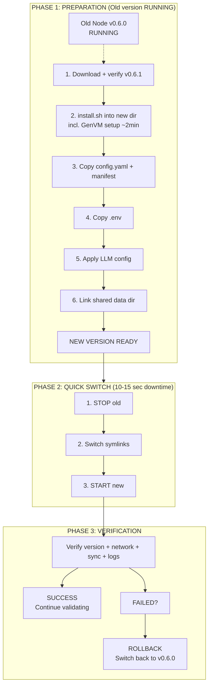

# GenLayer Validator Zero-Downtime Update Procedure

## Goal
Minimize validator downtime during updates by preparing the new version while the old version continues running.

Conventions (`VERSION`, `INSTALL_ROOT`, `NODE_DIR`, `MINOR`, `NODE_USER`) are the ones defined at the
top of `install-procedure.md`. `VERSION` is the **new** version; `OLD_VERSION` the running one.

## Process Overview



**Downtime comparison:**
- OLD WAY: STOP → Download → Extract → GenVM → START = **3-4 minutes**
- NEW WAY: [Prepare while running] → STOP → Switch → START = **10-15 seconds**

## Update Sequence (for v0.6.x patch updates)

> **Shared commands documented in `common-procedures.md` and `install-procedure.md`.**
> Run `pre-update-checklist.md` first.

### Phase 1: Preparation (Old Version Running)
All preparation steps happen WHILE the validator is actively running and validating:

```bash
# 1. Check current version and note it
curl -s http://localhost:9153/health | jq '{status, network, node_version}'
OLD_VERSION=$(basename "$(dirname "$(readlink -f /opt/genlayer-node/bin)")")   # e.g. v0.6.0
case "$OLD_VERSION" in v[0-9]*) ;; *) echo "cannot determine OLD_VERSION ('$OLD_VERSION') - stop" >&2; exit 1 ;; esac
VERSION=v0.6.1                                                  # the approved new version
INSTALL_ROOT=/opt/genlayer-node; NODE_DIR=${INSTALL_ROOT}/${VERSION}; NODE_USER=genlayer
MINOR=$(echo ${VERSION} | grep -oE '^v[0-9]+\.[0-9]+')

# 2. Download, verify and install the new version (GenVM setup is the slow part —
#    do it while the old node runs). Same commands as install-procedure.md Phase 2
#    (see: common-procedures.md -> "Download & Extract Node Software"), into ${NODE_DIR}.

# 3. Copy config + protocol manifest from the current version, keep the new GenVM path.
#    install.sh wrote the right genvm.root_dir into the NEW packaged config; the old
#    config may name a GenVM version the new package does not ship.
NEW_ROOT=$(sed -n 's/^ *root_dir: *//p' ${NODE_DIR}/configs/node/config.yaml)
sudo -u ${NODE_USER} cp ${INSTALL_ROOT}/${OLD_VERSION}/configs/node/config.yaml ${NODE_DIR}/configs/node/config.yaml
sudo -u ${NODE_USER} cp ${INSTALL_ROOT}/${OLD_VERSION}/configs/node/protocol-manifest.json ${NODE_DIR}/configs/node/
sudo -u ${NODE_USER} sed -i "s#^\( *root_dir:\).*#\1 ${NEW_ROOT}#" ${NODE_DIR}/configs/node/config.yaml
grep -n 'root_dir' ${NODE_DIR}/configs/node/config.yaml

# 4. Copy .env (secrets stay on the server; never print it)
sudo -u ${NODE_USER} cp -p ${INSTALL_ROOT}/${OLD_VERSION}/.env ${NODE_DIR}/.env
# Docker only: set NODE_VERSION=${VERSION} in the new .env, then pre-pull the image:
#   sudo -u ${NODE_USER} sed -i "s/^NODE_VERSION=.*/NODE_VERSION=${VERSION}/" ${NODE_DIR}/.env
#   (cd ${NODE_DIR} && sudo docker compose --profile node pull genlayer-node)

# 5. Apply the LLM config, preserving the current strategy and providers.
#    See install-procedure.md Phase 4 / common-procedures.md -> "LLM Strategy Selection".
OLD_CFG=$(cd ${INSTALL_ROOT}/${OLD_VERSION} && readlink -f "$(sed -n 's/^ *root_dir: *//p' configs/node/config.yaml)")/config
NEW_CFG=$(cd ${NODE_DIR} && readlink -f "${NEW_ROOT}")/config
sudo -u ${NODE_USER} cp ${NEW_CFG}/genvm-modules-llm-release.yaml ${NEW_CFG}/genvm-module-llm.yaml
grep -q 'genvm-llm-greybox.lua' ${OLD_CFG}/genvm-module-llm.yaml && \
  sudo -u ${NODE_USER} sed -i 's/genvm-llm-default\.lua/genvm-llm-greybox.lua/' ${NEW_CFG}/genvm-module-llm.yaml
# enable the same providers as before (<provider> from the common-procedures.md mapping):
sudo -u ${NODE_USER} sed -i '/^  <provider>:/,/^  [a-z]/ s/enabled: false/enabled: true/' ${NEW_CFG}/genvm-module-llm.yaml
# Docker only: re-create docker-compose.override.yml in ${NODE_DIR} (SKILL.md -> Docker Compose Deployment).

# 6. Link the shared data directory (genvm.db, ops.db, keystore/ — no copy, no resync)
test ! -e ${NODE_DIR}/data -o -L ${NODE_DIR}/data || { echo "${NODE_DIR}/data is a real directory - stop" >&2; exit 1; }
sudo -u ${NODE_USER} ln -sfn ../${MINOR}/data ${NODE_DIR}/data
ls -la ${NODE_DIR}/data/node/
```

**At this point, everything is ready for the new version.** Never start the new node while the
old one runs: both would open the same databases (one writer only), and two nodes with the same
operator must never run at once.

### Phase 2: Quick Switch (Minimize Downtime)
Now we do the fastest possible switch:

```bash
# 1. Stop old version
sudo systemctl stop genlayer-node

# 2. Update symlinks (very fast - <1 second)
# See: common-procedures.md -> "Setup Symlinks"
cd /opt/genlayer-node
for p in bin opt configs data docker-compose.yaml alloy-config.river alloy-healthcheck.sh genvm-module-web-docker.yaml .env; do
  sudo -u genlayer ln -sfn ${VERSION}/$p $p
done

# 3. Start new version immediately
sudo systemctl start genlayer-node

# 4. Refresh Alloy telemetry bind mount (CRITICAL for monitoring)
# See: sharp-edges.yaml -> "alloy-stale-bind-mount"
# The Alloy container's bind mount becomes stale when symlinks change.
# Without this restart, Alloy stops sending logs to Grafana.
# (The systemd unit's ExecStartPost also does this.)
sleep 5  # Wait for node to initialize
sudo docker restart genlayer-node-alloy 2>/dev/null || true

# Total downtime: 10-15 seconds (Alloy restart is async)
```

**Docker deployment:** from the new version directory, `sudo docker compose --profile node up -d`.
The release compose file names its project `genlayer-node`, so this recreates the existing
containers from the new directory.

> **IMPORTANT**: The Alloy restart is critical! Without it, the telemetry container
> continues reading from the old log path (stale bind mount) and your validator
> will appear offline to monitoring systems, potentially leading to penalties.
> See `sharp-edges.yaml` -> `alloy-stale-bind-mount` for details.

### Phase 3: Verification

> **See `common-procedures.md` -> "Verification Commands"**

```bash
# Check version, network and health
curl -s http://localhost:9153/health | jq '{status, network, node_version, genvm_version}'

# Check sync status
curl -s http://localhost:9153/metrics | grep -E '^genlayer_node_(synced|blocks_behind)'

# Monitor logs
sudo journalctl -u genlayer-node -f --no-hostname

# Verify Alloy telemetry is working (CRITICAL)
# Check that Alloy sees the current log file (timestamp should be recent)
echo "=== Alloy bind mount check ==="
echo "Host log file:"
ls -la /opt/genlayer-node/data/node/logs/node.log 2>/dev/null | awk '{print $6, $7, $8, $9}'
echo "Alloy container view:"
sudo docker exec genlayer-node-alloy ls -la /var/log/genlayer/node.log 2>/dev/null | awk '{print $6, $7, $8, $9}'
# Both timestamps should match! If they differ, Alloy has a stale bind mount.

# Check Alloy is actively tailing logs
sudo docker logs genlayer-node-alloy 2>&1 | tail -3
```

> **WARNING**: If the host and container timestamps don't match, run:
> `docker restart genlayer-node-alloy`
> See `sharp-edges.yaml` -> `alloy-stale-bind-mount` for details.

## For Major Version Updates (e.g., v0.6.x -> v0.7.x)

Major version updates may require:
1. New shared storage directory (e.g., `/opt/genlayer-node/v0.7/`) — follow the release notes on
   whether the data directory carries over (move it, never copy `ops.db` to another node)
2. Database migration (the node may migrate on first start; v0.6 renames a v0.5 `genlayer.db`
   to `genvm.db` and refuses to start if both exist)
3. Configuration format changes (diff the packaged template, step 3)

The principle remains: **Prepare everything first, then quick switch.**

**v0.5.x (Bradbury Phase 1 / Asimov) -> v0.6.x (Bradbury Phase 2) is NOT an in-place update.**
Phase 2 is a new chain (Arbitrum Orbit, chain id 4221) with new contracts and a new validator
registration. Do a fresh install (`install-procedure.md`) in a new directory, with a fresh data
directory; stop and disable the old node first.

## Downtime Comparison

| Method | Downtime | Validation Loss |
|--------|----------|-----------------|
| **Old way (stop first)** | 3-4 minutes | High - missed many validation rounds |
| **New way (prepare first)** | 10-15 seconds | Minimal - maybe 1 validation round |

## Key Principles

1. **Never stop the old node until the new node is 100% ready to start**
2. **GenVM setup is the slowest part** - do it while old node runs (install.sh runs it in the final directory)
3. **Shared data directory** - instant access to current sync state and node state (`genvm.db`, `ops.db`, keystore)
4. **Symlink switching** - takes <1 second
5. **Test the new version setup** - verify files exist before switching
6. **One node at a time** - never run old and new together (same databases, same operator)

## Rollback Procedure (if new version fails)

If the new version fails to start:

```bash
# 1. Stop failed new version
sudo systemctl stop genlayer-node

# 2. Switch symlinks back to old version
cd /opt/genlayer-node
for p in bin opt configs data docker-compose.yaml alloy-config.river alloy-healthcheck.sh genvm-module-web-docker.yaml .env; do
  sudo -u genlayer ln -sfn ${OLD_VERSION}/$p $p
done

# 3. Start old version
sudo systemctl start genlayer-node

# 4. Refresh Alloy telemetry (same reason as upgrade)
sleep 5
sudo docker restart genlayer-node-alloy 2>/dev/null || true

# Total rollback time: 10-15 seconds
```

The data directory is shared: if the new version migrated the databases on its first start, the
old version may not open them. Check the release notes before rolling back across a migration.

## Pre-Update Checklist

Before starting any update:

- [ ] Current node is running and synced
- [ ] Disk space available (check with `df -h`)
- [ ] Backup current .env and config.yaml
- [ ] Know the rollback procedure
- [ ] Have monitoring ready to check after switch
- [ ] Note current synced block number
